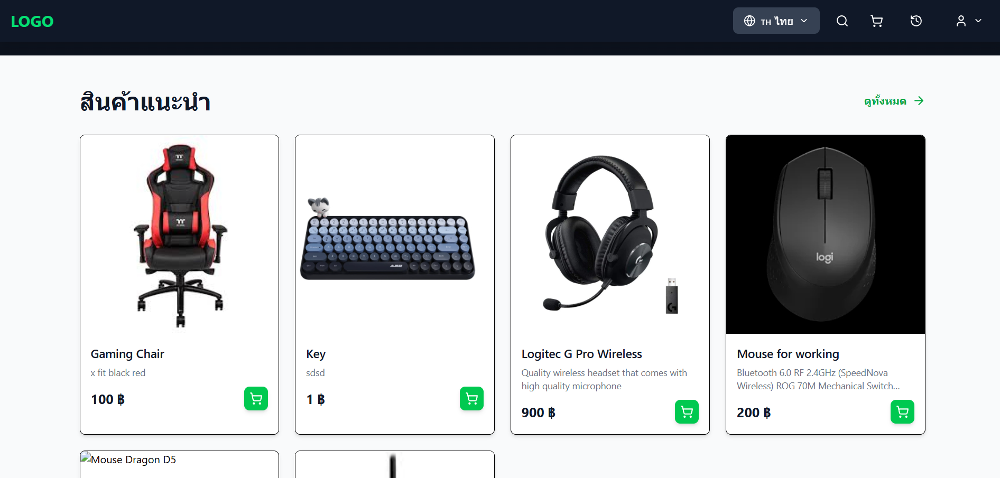

# BOSS Portfolio

Personal portfolio of **Rapeephat Phaphan (Boss)** — a Computer Science and Software Development Innovation student at Sripatum University, focused on full-stack web development and AI applications.

Built with **Next.js, React and JavaScript**, with a separate **Express API** for contact enquiries. The interface combines a dark blue visual identity, animated sections, bilingual content and real project screenshots.



*Screenshot of Gaming Gear, one of the projects featured in this portfolio.*

## Features

- Thai and English content with an in-page language switch.
- Responsive sections for introduction, background, projects, skills, education and contact.
- Project filtering for full-stack applications and AI/bot projects.
- Project dialogs with screenshot galleries, technology stacks and source links.
- Motion animations, mobile navigation and reduced-motion support.
- SMTP contact form with server-side validation, HTML escaping, a honeypot field and request rate limiting.
- Direct email and GitHub links as alternative contact channels.

## Technology

| Layer | Technologies |
| --- | --- |
| Frontend | Next.js 16 App Router, React 19, JavaScript / JSX |
| Styling | CSS, responsive media queries, Google Fonts |
| Animation and icons | Motion, Lucide React |
| API | Node.js, Express 5 |
| Email | Nodemailer over SMTP |
| API protections | Helmet, CORS, express-rate-limit, input validation |
| Screenshot tooling | Playwright |

Content is maintained in local data files; the portfolio itself does not require a database. The featured applications have their own repositories and infrastructure.

## Featured work

| Project | Overview | Source |
| --- | --- | --- |
| Gaming Gear | Full-stack gaming equipment storefront | [Frontend](https://github.com/bosspa01/ecom-web) · [API](https://github.com/bosspa01/ecom-api) |
| Solar AI | Solar-energy Q&A assistant using document retrieval | [Repository](https://github.com/bosspa01/solar-chat) |
| Anime Buddy | Discord anime recommendation bot | [Fork](https://github.com/bosspa01/ai-anime-discord-bot) |
| Voice to Clarity | LINE audio transcription and meeting summaries | [Fork](https://github.com/bosspa01/line-meeting-summarizer) |
| Food Flow | Multi-role food ordering application | [Repository](https://github.com/bosspa01/FoodApp) |

Forked projects are identified in the website and link to their upstream repositories. Screenshots show the featured projects; design artwork is labelled separately when no screenshot is configured.

## Repository structure

```text
frontend/
  src/app/           Next.js page and root layout
  src/components/    Sections, navigation, project gallery and contact form
  src/data/          Profile, project details, translations and screenshot paths
  src/styles/        Shared and section-specific stylesheets
  public/            Profile images, favicon and project screenshots
  scripts/           Optional screenshot capture utility
backend/
  server.js          Express application and middleware
  routes/            Contact endpoint and rate limiter
  controllers/       Contact request handling
  config/            SMTP transport configuration
  utils/             Input validation and HTML escaping
```

## Run locally

Use **Node.js 24 LTS** and npm. Install dependencies separately in each application.

**Backend — terminal 1**

```powershell
cd backend
npm ci
Copy-Item .env.example .env
# Configure SMTP in .env before using the contact form.
npm run dev
```

Only copy the example when you do not already have a local .env file.

**Frontend — terminal 2**

```powershell
cd frontend
npm ci
npm run dev
```

Open [localhost:3000](http://localhost:3000). The API health endpoint is [localhost:4000/api/health](http://localhost:4000/api/health).

For Windows, START_FRONTEND_WINDOWS.bat and START_BACKEND_WINDOWS.bat provide equivalent development launchers.

## Environment variables

| Application | Variable | Purpose |
| --- | --- | --- |
| Frontend | API_URL | Backend origin used by the Next.js /api rewrite; defaults to http://localhost:4000 locally |
| Backend | PORT | HTTP port; use the hosting platform's assigned value |
| Backend | FRONTEND_ORIGINS | Allowed frontend origins, separated by commas |
| Backend | SMTP_HOST, SMTP_PORT, SMTP_SECURE | SMTP connection settings |
| Backend | SMTP_USER, SMTP_PASS | SMTP credentials, stored only in local or hosting secrets |
| Backend | CONTACT_TO_EMAIL | Destination for portfolio enquiries |
| Backend | TRUST_PROXY | Set to 1 only behind one trusted reverse proxy |

The frontend sends requests to /api/contact; Next.js proxies them to the configured backend. Production must use an HTTPS backend origin instead of localhost. SMTP credentials belong exclusively on the backend.

When SMTP is missing or delivery fails, the form reports the problem and offers direct email; it does not report a successful delivery.

## Production checks

```powershell
cd frontend
npm ci
npm run build
npm start
# In each app directory:
npm audit --omit=dev
```

See [DEPLOYMENT.md](DEPLOYMENT.md) for the proposed Vercel frontend / Render backend setup, environment configuration and release checks. Hosting resources and deployment are configured separately from pushing this repository.

## Content and screenshots

- Edit personal details in frontend/src/data/profile.js.
- Edit project descriptions in frontend/src/data/projects/.
- Edit translations in frontend/src/data/languages/.
- Place real screenshots under frontend/public/project-shots/ and list their public paths in frontend/src/data/project-shots.json.
- Keep private conversations, credentials and personal account details out of published screenshots.

## Documentation

- [Thai setup guide](README_TH.md)
- [Beginner walkthrough](GUIDE_FOR_BEGINNERS_TH.md)
- [Complete code and architecture guide](CODE_GUIDE_TH.md)
- [Deployment guide](DEPLOYMENT.md)

## Author

**Rapeephat Phaphan (Boss)** — [GitHub](https://github.com/bosspa01)

Source is provided for reviewing this portfolio. No open-source license is granted by this repository; project screenshots and third-party assets remain subject to their respective rights.
